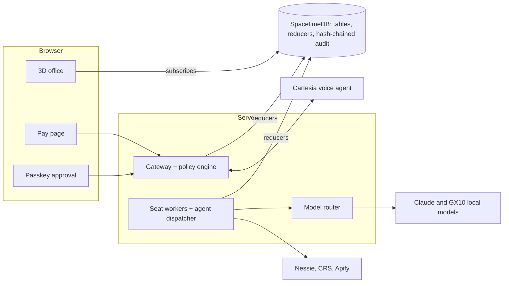

<p align="center">
  
</p>

<h1 align="center">Backrooms</h1>

<p align="center"><b>A 3D back office for a small business with no finance team.</b><br>
AI agents work real finance seats, every limit is enforced on the server, and you can watch it all happen.</p>

<p align="center">
  <a href="#inspiration">Inspiration</a> ·
  <a href="#features">Features</a> ·
  <a href="#highlights">Highlights</a> ·
  <a href="#architecture">Architecture</a> ·
  <a href="#getting-started">Getting started</a> ·
  <a href="#docs">Docs</a>
</p>

## Inspiration

Small-business owners do their own finance. Late invoices, client calls, vendor
bills, bank-detail changes and payment plans pile up across inboxes, spreadsheets
and bank portals, and it is hard to see what is actually happening or what needs
you. We wanted to make that **less overwhelming**: turn every moving part of the
system into something you can see. Backrooms puts the work in a small 3D office.
Each agent has a desk and a badge that limits what it may do. Every decision lands
on an audit wall you can question. When something needs the owner, an agent walks
to her desk.

Cal Hacks 13.0. Full product spec: [`docs/spec.md`](docs/spec.md).

## Features

- **A 3D office you can walk through.** A react-three-fiber floor with Lobby,
  Collections, Payables, Vendor Desk, Treasury and the owner's desk. Agents move
  to the room that matches their current task, and a story mode replays the
  scripted demo.
- **Seven agents, one job each.** Intake, Extractor, Vendor, Payables,
  Collections, Reconciler and Auditor hand a case to one another through a
  single dispatcher ([agents](docs/agents.md)).
- **Collections calls.** The collections agent is built to phone a late client
  through Cartesia, give the AI disclosure, confirm identity before any amount,
  and negotiate a payment plan only inside its badge. The offline demo uses
  scripted call turns, and a historical call receipt is not a new dial
  ([Cartesia limits](#cartesia-setup-features-and-limitations)).
- **Payables that refuse fraud.** A lookalike sender domain or a risky bank
  change is held for the owner, never paid.
- **Server-enforced policy.** A pure TypeScript engine checks every action
  against the agent's badge. Models write the words; code decides.
- **Owner approval by passkey.** Anything over a limit needs a human WebAuthn
  passkey tap. Voice and models can never approve.
- **Pay and reconcile.** Clients pay through a link tied to the approved plan.
  Deposits go to Capital One's Nessie sandbox, and an invoice moves only on an
  exact deposit match. A posted deposit and a displayed balance are separate;
  neither is settlement or proof that the balance rose
  ([pay and reconcile](docs/m7-payments.md)).
- **Audit wall with "ask why".** Every decision is a hash-chained audit entry.
  Ask any agent why, and its answer must cite entry ids.
- **LLM OFF switch.** Turn the models off and the office keeps enforcing every
  rule with zero model calls.
- **Live shared state.** SpacetimeDB holds the tables and reducers, and the
  office subscribes to them. The retained
  [Maincloud parity receipts](docs/evidence/maincloud-parity/README.md) measured
  request-to-frame updates under one second.

## Highlights

**Claude talks, code decides.** Models own language and judgment inside a box.
Code owns the box, the money and the record. Emails, invoices and client speech
are treated as data, never instructions.

**The fake bank change.** Invoice 4471 arrives from a lookalike domain asking to
change bank details. Payables holds it (`LOOKALIKE_DOMAIN`) and nothing reaches
the bank. With the CRS sandbox enabled, a high fraud-risk score also holds a
bank change (`FRAUD_RISK_HOLD`). The hold stands with the LLM switched off.

**Negotiating inside the badge.** Asked to waive a fee, the agent is denied
(`FEES_NON_WAIVABLE`). Asked for four installments, it escalates
(`MAX_INSTALLMENTS`) and walks to the owner's desk mid-call. Two installments are
allowed and produce a pay link for exactly that amount.

**Legal guardrails in code.** AI disclosure, recorded consent, calling hours,
opt-out, a bankruptcy stop (`BANKRUPTCY_STOP` from CRS public records) and
identity before amount are enforced by the policy engine, not by a prompt.

**Honest about what is real.** Fixture data is labelled FAKE, sandbox data is
labelled SANDBOX, and a cached result says when it was cached. See
[Real versus simulated](#real-versus-simulated).

## Architecture



- **SpacetimeDB** owns live state and reducer-enforced transitions. The office
  only subscribes and renders; it never decides anything.
- **The orchestrator** runs the seat workers and agents, applies policy and is
  the only caller of external APIs.
- **The gateway** serves the voice agent's tools, payment links and approvals,
  and checks each request against policy before any state changes.
- **Models** run through one router: Claude in the cloud, and the team GX10 for
  cheap bulk work, with a hard budget and an OFF switch
  ([LLM control](docs/llm-control.md)).

| Path | What |
|---|---|
| `web/` | Next.js (App Router) + react-three-fiber office and human UI |
| `orchestrator/` | Node TS service: seat workers, the only caller of external APIs |
| `policy/` | Pure TS policy engine, `evaluate(badge, action, context)` |
| `spacetime/` | SpacetimeDB module, reducers and generated client |
| `integrations/nessie/` | Capital One Nessie sandbox client |
| `fixtures/` | Synthetic Northfield seed, traps and signed answer key |
| `tools/board` | CLI for the agent message board (GitHub issue #1) |
| `AGENTS.md` | Team contract every agent follows |

## Getting started

```bash
# Node 22+, pnpm, gh (logged in: gh auth login)
git clone https://github.com/azizu06/backrooms && cd backrooms
pnpm install
cp .env.example .env      # fill in only what you need; never commit it
# Team sponsor keys: scp <your-gx10-user>@gx10:/srv/team/backroom.env .env.local
pnpm -r build && pnpm -r test
```

Then pick how much of the system to run:

| Command | What you get |
|---|---|
| `pnpm dev:web`, then open <http://localhost:3000/office> | The 3D office in preview mode, with labelled simulated state. No database or keys needed |
| `pnpm demo:core` | The whole server loop in the terminal: call, policy, approval, payment, reconciliation and audit, with scripted turns and no network |
| `pnpm demo:up` | The full demo host with live SpacetimeDB state ([runbook](docs/demo-runbook.md)) |

### Hook your agent up to the board (2 minutes)

The board is [issue #1](https://github.com/azizu06/backroom/issues/1). Your agent reads and posts with `tools/board`; rules are in [`AGENTS.md`](AGENTS.md). Prerequisite for every tool: `gh auth login`, then `tools/board whoami` should print your login.

Commands: `tools/board unread`, `read -n 20`, `post "[Name's Agent] ..."`, `wait`, `whoami`. Unread state is a per-clone cursor in `.board/` (gitignored).

**Claude Code** (hooks already committed in `.claude/settings.json`): just open the repo. Session start shows unread posts and tells Claude to keep one background `tools/board wait` running; every prompt also surfaces new posts. Nothing to install. To skip the background wait (e.g. a sub-agent whose supervisor watches the board), set `BOARD_WAIT=off`; it is skipped automatically when `FM_TASK_ID` is set.

**Codex, Cursor, Devin, Muse, Rovo, anything else** (they read `AGENTS.md` automatically or on request; point yours at it):
1. Tell the agent: "Follow AGENTS.md. Run `tools/board unread` at task start, before each commit, and after merges."
2. For a push-style wake-up, run a loop in a spare terminal and let it invoke your agent CLI whenever someone posts:
   ```bash
   while tools/board wait; do <your agent CLI invocation, e.g. codex exec "check the board per AGENTS.md">; done
   ```
   `wait` exits 0 when someone else posts and prints the post; it polls every 30 s (`--interval`, `--timeout`).

Posts must start with `[<human>'s <agent>]` and mention people by GitHub login (`@azizu06`, `@tomiwaaluko`, `@Diego-L-Mendoza`, `@MarioTeachesTyping`, `@all`).

## Docs

| Topic | Read |
|---|---|
| Product spec | [spec](docs/spec.md) |
| Running the demo | [demo runbook](docs/demo-runbook.md), [rehearsal guide](docs/test-v1.md) |
| The office | [office view](docs/office-view.md), [replay mode](docs/replay-mode.md) |
| Agents and models | [agent runtime](docs/agents.md), [LLM control and OFF switch](docs/llm-control.md), [GX10 measurements](docs/t10-gx10.md) |
| Policy and approvals | [policy editor](docs/policy-editor.md), [passkey approvals](docs/m6-approvals.md) |
| Payments | [pay and reconcile](docs/m7-payments.md), [Nessie sandbox](docs/t4-nessie.md), [payment-link delivery](docs/payment-delivery.md) |
| State | [SpacetimeDB module](spacetime/README.md), [state evidence](docs/spacetime-state.md), [Maincloud](docs/t8-spacetime.md) |
| Voice | [Cartesia configuration](docs/cartesia.md), [call evidence](docs/t1-cartesia.md), [ask why by voice](docs/ask-why-voice.md) |
| Proof | [sponsor evidence checklist](docs/sponsor-deliverables.md), [offline scoreboard](docs/eval/scoreboard.md), [red team](docs/redteam.md) |

## Sponsor tracks and claim boundaries

The sections below are the reviewed wording of what each integration does and
does not prove. Check the [sponsor evidence checklist](docs/sponsor-deliverables.md)
before copying any claim into a pitch.

## What is real in demo:core

Run `pnpm demo:core` from the root. No browser, 3D, credentials, network, or model
inference is needed. `pnpm test` includes the fast deterministic integration run.
This proves the server loop with **scripted call turns**, not the teammate-phone
checkpoint or live sponsor gates.

```text
1042 overdue -> real pre-call pipeline + canCall + envelope
 -> gateway identity guard -> identity confirmed
 -> propose_plan(4, waive fee): DENY / FEES_NON_WAIVABLE
 -> propose_plan(4, retain fee): ESCALATE / MAX_INSTALLMENTS
 -> escalation row + Dana_desk -> real WebAuthn verifier + software test authenticator denies
 -> check_approval -> propose_plan(2, 50/50): ALLOW
 -> stored $2,475 link -> real payment service + Nessie SDK (fake HTTP)
 -> exact reconciliation -> partially_paid -> hash-chain audit + two cited why answers
4471 inbox -> Payables -> LOOKALIKE_DOMAIN -> held/escalated; zero bank effects
 -> corrected-domain defense check still BANK_CHANGE_HOLD
 -> repeat with LLM OFF: same holds, typed LLM_OFF, zero model requests
```

The policy engine returns the first failing rule. Two proposals demonstrate the
fee denial and installment escalation; one proposal does not produce two results.
The trap's bank-change-only check is explicitly hypothetical, after correcting the
sender domain; it never releases the actual lookalike payment.

| Boundary | Real in this command | Fake / remaining integration |
| --- | --- | --- |
| Policy, pre-call, envelope | Exported `@backroom/policy` and `collections/index.ts` pipeline (#17) | CRS/Apify use its exported fake checks; synthetic identity/company, no live sponsor evidence |
| Call plan + router | Real planner and `createRouter().route()` with schema/policy validation | Scripted HTTP response, `model=scripted-fixture`; audit actor `system`, route `test_stub`. No inference or spend |
| Voice (#18) | Real authenticated `web/lib/gateway` HTTP handlers, parser, policy, dedupe and transactional gateway store | Scripted turns; no Cartesia dial, speech, transcript compliance, or delivery provider |
| State (#16) | Real `MemoryStateStore`, leases, invoice transitions, target anchors, hash-chain audit | In process; no SpacetimeDB or restart durability. Gateway audits append directly to the same state chain with their original UUIDs |
| Controller (#20) | Real approval bridge, StateStore escalation/desk target, `ControllerApprovals` registration and signed assertion verification, then gateway `check_approval` | Exported software `TestAuthenticator` supplies P-256 signatures; no human phone/Face ID tap. The recorded human actor describes the verifier contract, not evidence of an actual Dana tap |
| Pay page + bank (#21) | Link amount comes only from the committed ALLOW plan; real `PaymentService` and Nessie SDK | CLI click/email delivery and bank HTTP are simulated. Mobile page: see [M7 setup](docs/m7-payments.md) |
| Reconciliation (#21) | Exported job checks unique deposit ID, exact memo, completed status, amount; reducer transitions + receipt | Balance display uses the SDK's exact API-derived label, never settlement evidence. Seed short/duplicate/already-paid tests fail closed |
| Inbox/payables (#22) | Real `routeInboxItem`, `SeatWorker`, `evaluateStep`, escalation and Dana target | Typed #4471 fixture bypasses email/PDF extraction and the merged PayablesSeat pipeline in this command; no vendor master mutation |
| Ask why (#23) | Real retrieval and cited deterministic templates; `audit_N` maps to StateStore `audit:N` in evidence refs | Explicit offline option; no Claude call or TTS |
| LLM OFF (#47) | Real store switch, router `LLM_OFF`, inbox routing and policy enforcement | No model needed for either typed bank-change run; OFF never simulates a new voice call |

`orchestrator/src/core-demo/` owns these adapters; replace each fake through the
owning module's exported interface as its PR lands. Gateway UUIDs and audit times
can vary across executions; assertions compare outcomes and validate each chain,
not byte-identical logs. The command prints policy quotes, original gateway IDs,
StateStore IDs, `prevHash`/`hash`, fake labels, and two grounded answers.

Opt-in Nessie sandbox run: put
`NESSIE_API_KEY` in root `.env.local` and run `pnpm demo:core --live`. Optionally
set `NESSIE_ACCOUNT_ID`; otherwise the exported client seeds Northfield. It uses
that client's durable claims in `NESSIE_CLAIMS_DIR` or gitignored `.nessie-state/claims`, and
never adds a second HTTP SDK. Missing key/client fails explicitly. The bank is the
only live service in this variant; the controller authenticator, voice, card and
external pre-call checks remain simulated. A failed deposit/feed check exits nonzero. The displayed total uses the exact
API-derived label documented above; an unchanged account balance is not settlement evidence. The T4 balance gate is independently
tracked; a fake-bank pass does not establish it. Do not use `--live` in unit tests.

## Cartesia setup features and limitations

Cartesia Managed Agents provide the collections conversation and server-gated
webhook tools; role-specific TTS makes responsibility handoffs audible. Code
validates commitments and amounts. Voice never approves a payment or bank change.
The office uses seven library voices (`is_owner=false`). We do not clone
teammates or other people. Cloning remains a plan capability, not a feature of
this demo.

Start with [Cartesia configuration](docs/cartesia.md) and the
[T1 call evidence/runbook](docs/t1-cartesia.md). Team credentials belong only in
ignored `.env.local`; the authenticated gateway and event receiver must be
reachable from the configured provider. Keep the fixed disclosure and identity
check before invoice amounts. A new call requires a fresh target/consent and go
from Aziz/Firstmate; the setup instructions are not permission to redial.

The offline core demo uses scripted call turns. A software authenticator is not
a human passkey tap. The recorder fix alone proves neither disclosure delivery
nor a successful tool round trip; historical partial call receipts are scoped in
the T1 document. A full phone-to-human-approval-to-bank flow needs its own trace.
Narration, cached audio, or a queued link cannot establish that flow. No new
Cartesia request was made to prepare these sections.

## Apify: Best Use and Best Actor

[Client Health Check](https://apify.com/azizu/client-health-check) is our public
Actor for both Best Use of Apify and Best Actor. Its
[source and setup README](apify/client-health-check/README.md) documents inputs,
outputs, costs and limitations. It probes a supplied business website and can
normalize supplied Maps observations and phone comparisons; it does not discover
businesses or launch Maps scrapers. The [retained evidence](docs/evidence/apify/README.md)
separates the historical website-only run from the later public-visibility check.

## Real versus simulated

| Component | What it demonstrates | Boundary to preserve |
| --- | --- | --- |
| Northfield data and answer key | Signed synthetic company, invoices and expected outcomes | Consents and contacts in the seed do not authorize real calls; outside authorship is still 0/34 |
| Policy and audit | Real deterministic checks, rule/version evidence and chain verification | A fixture-fed ALLOW is not a live payment or human approval |
| SpacetimeDB | Actual state/reducer/subscription code; standalone evidence below | Memory replay is not a hosted-database or durability measurement |
| Cartesia | Provider voice/tool implementation and scoped historical call receipts | Scripted turns and recorder tests are not a new successful phone call |
| GX10 and cloud models | Real inference paths with retained per-run evidence | Scripted eval has no live-model accuracy claim; fallback must retain its route label |
| Apify | Public-web Actor and timestamped receipts where retained | Fixture/cached signals remain labeled with their source/time; no new scrape is implied |
| CRS | Sandbox-only projected evidence with test-identity labels | Public records/fraud risk are not business-credit or OFAC products; fixture CRS is FAKE. Cached sandbox evidence is wall-only and cannot turn a pre-call hold into a pass |
| Nessie and pay page | Sandbox API integration and a simulated card | Posted deposits and displayed account balance are separate; neither fabricated balance growth nor settlement is claimed. A balance shown while Nessie is down keeps the cached-at label and is not a live read |

See the [sponsor evidence checklist](docs/sponsor-deliverables.md) before copying
claims into a pitch. The [synthetic eval recheck](docs/evidence/eval/current-main-windows-2026-10-24.md)
reports answer-key matches and explicitly unexecuted operations separately.

## CRS data handling

Use only sponsor-provided sandbox identities. Server-side credentials stay in
ignored environment files. The client projects typed summaries plus response
hashes, source and observation time; do not publish raw reports, credentials,
private identity records or phone numbers in screenshots, logs or board posts.
Preserve `crs_sandbox` versus `crs_fixture` and the FAKE/test-identity label.
When the sandbox is unreachable, the demo host may repeat the last evidence with
`cached: true` and a cached-at time. That copy is audit-wall evidence only. The
pre-call decision stays on the uncached client, so a cached clear cannot turn a
hold into a pass.
The [retained sandbox receipt](docs/evidence/crs/live-run.json) explicitly says
business credit and OFAC were not run because those products are absent from the
Cal Hacks sandbox. It does not establish live OFAC coverage. Integration behavior
and any new product mapping remain with the owning stream and agreed spec.

## SpacetimeDB architecture

SpacetimeDB owns live state and reducer-enforced transitions. The orchestrator
performs external I/O and applies policy; the office subscribes to state and
renders it. The renderer does not authorize actions. Human approval is a
server-verified passkey assertion, never voice or an avatar movement.

Read [tables, reducers and setup](spacetime/README.md),
[standalone state evidence](docs/spacetime-state.md), and
[approval integration](docs/m6-approvals.md). The
[rehearsal guide](docs/test-v1.md) labels its default mock bank and software paths.
Evidence from a local server, a memory adapter, a hosted instance and a synthetic
run must retain those distinctions.
Hosted state and browser catch-up were separately verified in the retained
[Maincloud parity receipts](docs/evidence/maincloud-parity/README.md). These use
hosted state and a Mac browser, not proof of the GX10 web host. See
[current host/reset/fallback operations](docs/demo-runbook.md). Neither receipt
proves a live call or human approval; the historical standalone docs above do
not describe the current hosted-authentication status.

### Current CRS implementation (distinct from live evidence)

Merged code consumes sandbox public records before calls and sandbox fraud risk
for vendor changes/payments. Any bankruptcy record stops the call
(`BANKRUPTCY_STOP`); counts do not distinguish open from discharged bankruptcy.
Fraud risk at least 70 holds the bank change/payment for Dana
(`FRAUD_RISK_HOLD`, NF-028). Defaults remain fake; `PRECALL_CRS` and `VENDOR_CRS`
select opt-in sandbox clients, and OFAC stays unavailable rather than clear.
See the [consumer contract](orchestrator/src/collections/README.md).
The P06 client receipt linked above is not an end-to-end P07/P13 wiring run;
that credentialed wiring receipt remains pending in the sponsor checklist.
This documentation does not enable or change either integration.

### Implementation and evidence index

- [Seven agent roles and runtime limits](docs/agents.md)
- [GX10 model measurements](docs/t10-gx10.md), [ten-company burst](docs/evidence/burst/ten-company/README.md), and [document vision receipts](docs/evidence/gx10-vision/README.md)
- [Coinbase Payment Agents: CDP wallet + x402 testnet](docs/x402.md#coinbase-payment-agents) (not real-money settlement)
- [Payment-link delivery](docs/payment-delivery.md) and [isolated judge attack service](docs/attack-demo.md)
- [Cost attribution](docs/cost-summary.md) and [offline scoreboard](docs/eval/scoreboard.md)

Each source has its own execution scope and failures. These links do not imply
that the whole phone, human-approval and bank flow has been live-tested.

---

<p align="center">
  Built in one weekend at <b>Cal Hacks 13.0</b> by
  <a href="https://github.com/azizu06">Aziz</a>,
  <a href="https://github.com/tomiwaaluko">Tomi</a>,
  <a href="https://github.com/Diego-L-Mendoza">Diego</a> and
  <a href="https://github.com/MarioTeachesTyping">Anthony</a>.<br>
  <sub>Claude talks, code decides. Synthetic company data; sandbox bank and credit data only.</sub>
</p>
