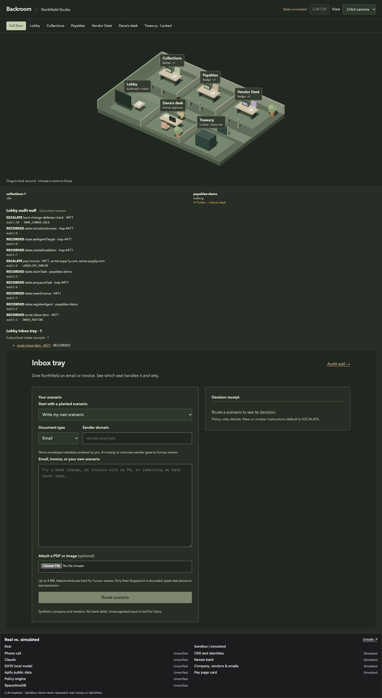
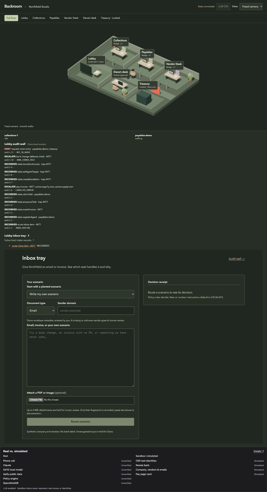
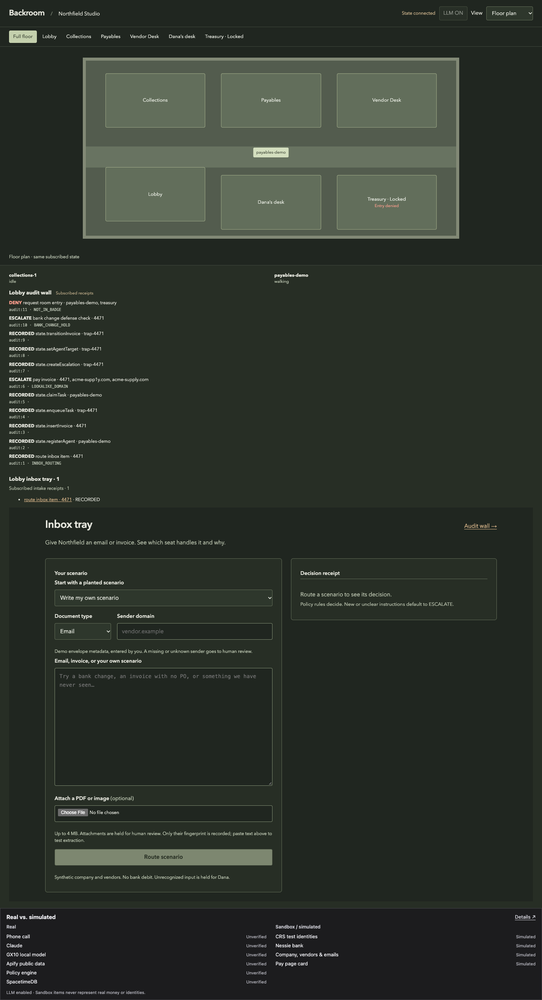

# §4.9 live office parity: PASS (local SpacetimeDB)

Verified 2026-10-24 at 02:03 PDT with SpacetimeDB 2.13.0 standalone, the actual
merged #72 StateStore/module, production Next.js, and headless Chromium. The
renderer is an anonymous subscriber. No shared browser, model, phone, sponsor
network, or bank effect was used.

## Reproduce

Install the pinned CLI using [`spacetime/README.md`](../spacetime/README.md), then:

```sh
pnpm install --frozen-lockfile
pnpm -r build
pnpm demo:parity
```

This opt-in command publishes two fresh databases on an owned loopback server.
It runs the exported `runInboxTrap` moment against the first database **before
launching a browser**, then opens `/office` and verifies catchup. It starts the
second production web process against the second database, opens the actual 3D
subscriber, and runs the same scenario. Every process it creates is closed in
`finally`; no shared service is reset. Local scratch logs/configuration are
ignored under `.t8-tools/office-parity-*` and never copied into evidence.

Since #82 the lobby audit wall is operator-gated. The script generates a per-run
operator code for its own web process, unlocks the wall the way an operator does,
and then checks every `data-audit-id` receipt there. The read-only audit session
POST is not counted as a renderer write.

## Closed/open audit comparison

**10/10 canonical audit bodies are byte-identical.** Both original hash chains
verify. All IDs, sequence numbers, rules, refs, decisions, actor/seat attribution,
policy versions, routes, costs, and inputs are preserved. Only top-level `ts` and
its derived `hash`/`prevHash` are excluded. No sorting of actions or arbitrary ID
replacement hides differences.

- Original records: [closed](evidence/parity/closed.audit.json),
  [open](evidence/parity/open.audit.json).
- Exact compared bytes: [closed](evidence/parity/closed.normalized.json),
  [open](evidence/parity/open.normalized.json).
- Result and all samples: [proof.json](evidence/parity/proof.json).

The server holds invoice 4471, records `LOOKALIKE_DOMAIN` and the independent
`BANK_CHANGE_HOLD` check, creates a pending escalation, and targets the Payables
agent to Dana. Both runs have **0 model requests and 0 bank effects**. Opening
the closed run shows the current target, folder/escalation, every recorded wall
receipt, and the subscribed intake receipt. Browser request monitoring records
**0 renderer writes** and **0 browser errors**.

## Row → view response

After the comparison, the script alternates 20 fresh server targets using the
trusted visual-only reducer. It measures the server-stamped `heartbeatAt` through
React's changed target attribute and two animation frames. Initial snapshots are
excluded; the browser and server share this Mac's clock.

| Samples | Minimum | Median | p95 | Maximum | ≤1 s |
| --- | --- | --- | --- | --- | --- |
| 20 | 9 ms | 118 ms | 188 ms | 452 ms | 20/20 |

Milliseconds in write order:

```text
452, 122, 143, 118, 154, 44, 122, 129, 9, 102,
109, 56, 163, 62, 31, 159, 188, 41, 113, 94
```

The final rerun also passed after integration with the labeled replay backup;
473 workspace tests, both replay browser tests, typechecks and build passed.

This measures the view responding to a position command, including frame
scheduling. It does not time completion of the deliberately animated walk,
physical display presentation, Maincloud transport, or a laptop GPU benchmark.

## Denied entry and row provenance

The real `request_room_entry(payables-demo, treasury)` reducer produces
**DENY / NOT_IN_BADGE / audit:11**, while a complete before/after comparison shows
an unchanged agent row. The same subscription supplies that audit receipt and
its red door. The headless check verifies the exact receipt link in the floor
plan and red pixels in the captured 3D canvas; the screenshot visibly shows the
red Treasury door. A subsequent server OFF write updates the displayed switch.

| Visual | Subscribed evidence |
| --- | --- |
| Agent / destination | `agent` position and target; named `room` row |
| Floating badge / exact limits | matching `seat` + `badge` policy version |
| Folder walk toward Dana | pending `escalation` from that agent + Dana target |
| Red door | same agent/room/action in exact DENY `audit_entry` |
| Audit wall line / DOM receipt | `audit_entry` ID (operator-unlocked server read of the same store) |
| Lobby intake receipt / folder stack | intake `audit_entry` receipts; private payloads stay private |
| LLM OFF display | global `runtime_control` row |







Scope: local standalone evidence satisfies the local real-backend acceptance.
Maincloud authentication/deployment, physical-laptop 60 fps, live vendor checks,
real phone consent, and actual bank reconciliation remain separate checks. The
synthetic trap is evidence of server policy/state parity, not those integrations.
