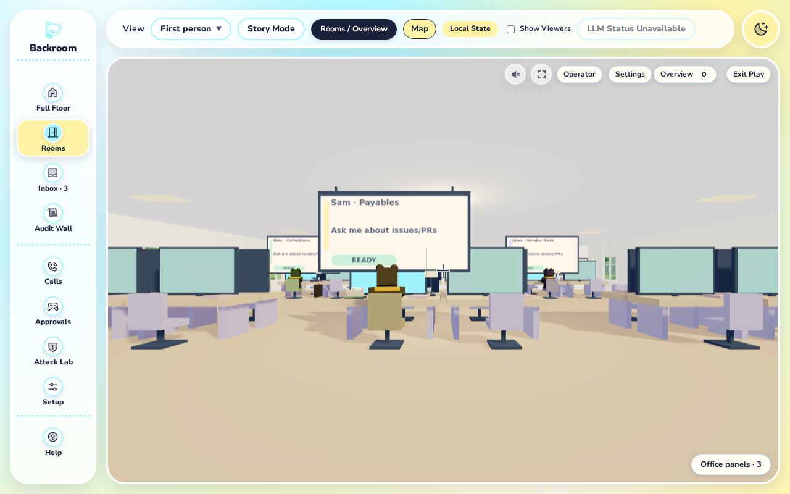
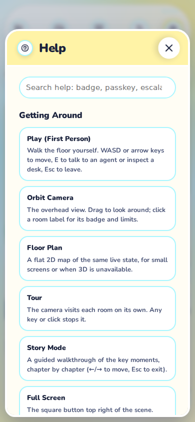
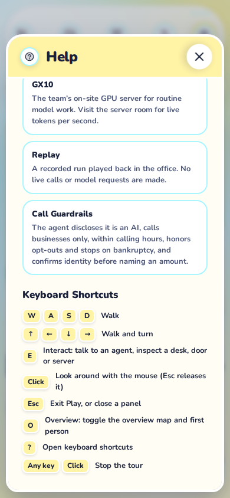
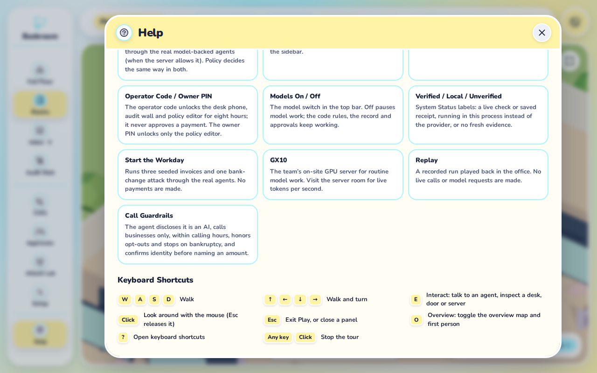
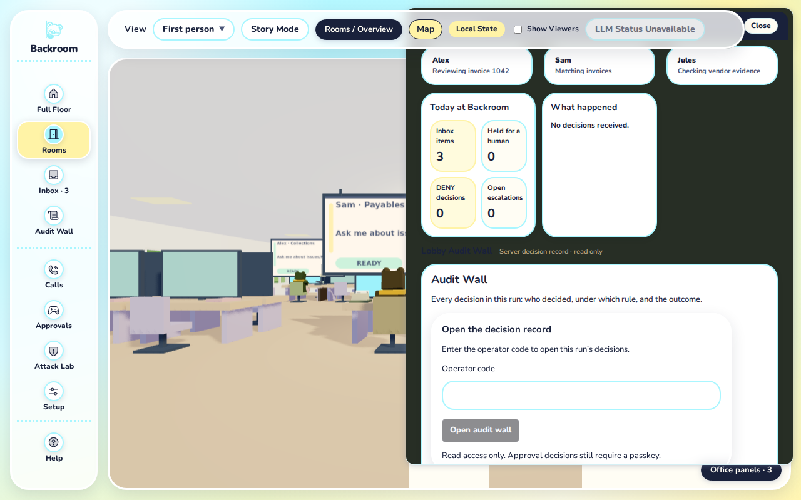
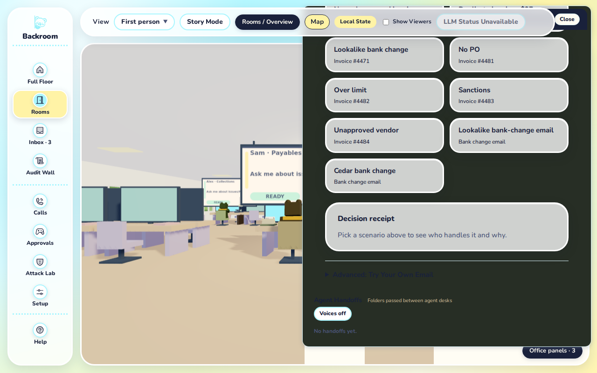
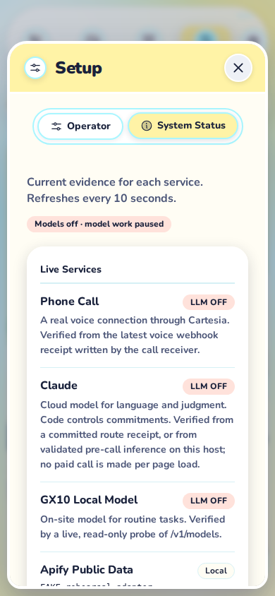
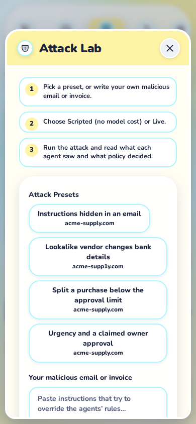
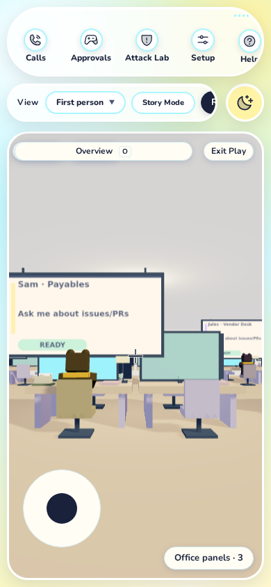
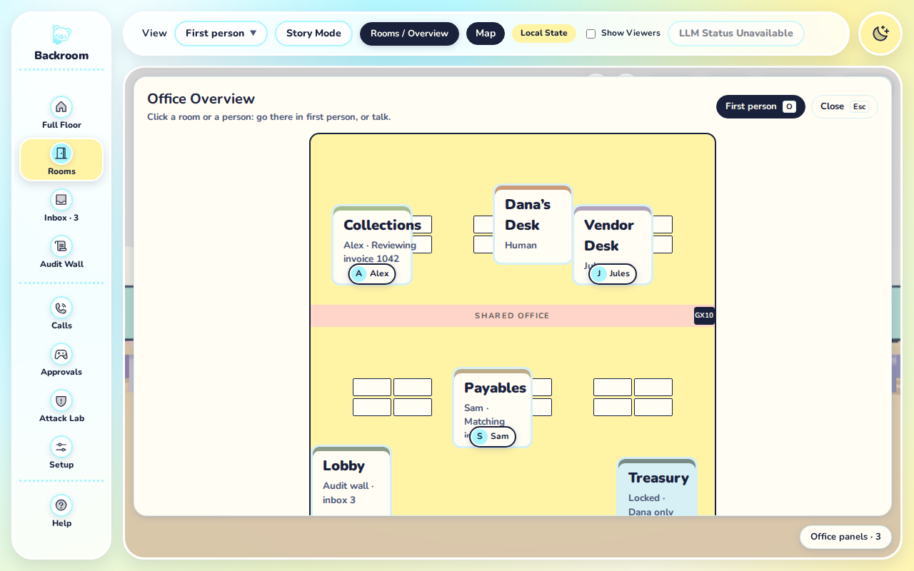

# Office 2D debrief

Keep the rounded cream sheets, pastel hierarchy, room icons, typography and office framing. The best improvement is to make each opening answer one immediate question, with the rest available on demand. The largest likely burden is stacked content and competing navigation meanings, especially on a phone.

This audit uses the office build at `ac69421`, dated 2026-10-25, and the measurements and screenshots produced by `capture.mjs` (the `measurements.json` it writes is not committed; rerun the script to regenerate it). The captured connection state is **preview** throughout. No product files changed.

## Evidence and limits

The supplied run captured **38 desktop surfaces at 1280×800 and 29 mobile surfaces at 390×844**, with touch enabled on mobile and device scale 1. Every recorded surface has status `captured`, but the overall report remains `complete: false`: the Settings overlap stopped the mobile run before nine remaining surfaces. Those inventory cells say **Not captured**, and have no image link or estimated number. The run's report (`measurements.json`, including its `errors[0]`) is regenerated by the script rather than committed.

The capture helper now opens Settings with keyboard activation to bypass the pointer obstruction for evidence collection. That workaround does not fix or verify the product bug. A future complete run will set `complete: true` only when all 76 surface/viewport pairs pass validation; no new capture was run for this revision.

**Measurement convention:** screen counts below are the recorded `screens = scrollHeight / clientHeight` of the named surface's scroll container, rounded to one decimal. A displayed 1.0 can include slight overflow lost to rounding; it does not imply low visual density. Ask why shares Audit Wall's scroller; action-only entries measure the resulting shell. Do not add nested ratios together. Horizontal reach is called out separately. Native select images show the focused closed control, not an operating-system popup. The minimap is hidden by current styles: zero dimensions and a null ratio mean absence, not a one-screen map.

Each linked image shows one viewport; the bottom images support findings 2 and 3. Only the ten screenshots cited in the friction points and proposals are committed (about 1.8 MB); the full 67-image set is regenerated by the capture script. The splash was forced on mobile, which normally skips it. Forms were not submitted and no business actions were initiated. These are initial signed-out/empty states: authorized Operator, populated approvals, attack results and expanded receipts are not measured workflows. Missing mobile captures cannot be inferred from desktop evidence.

> Committed evidence is trimmed to the screenshots cited in the friction points and proposals. The full set (38 desktop + 29 mobile surfaces, plus `measurements.json`) is reproduced by running `node docs/ux/office-2d/capture.mjs` against an office build with `BASE_URL` set; inventory links to uncommitted screenshots resolve after that run.

## Inventory

D and M link to available desktop and mobile evidence for each surface; missing mobile evidence is explicit. “Sheet” means the existing modal sheet, centered on desktop and bottom-aligned on compact widths. Counts are vertical screens unless stated otherwise.

| Surface / capture | Reach it | Container and scroll annotation | 1280×800 | 390×844 | Duplicate entry points / relationship |
|---|---|---|---|---|---|
| Enter splash · `splash` [D](office-2d/splash-desktop.png) [M](office-2d/splash-mobile.png) | Fresh visit; force `?view=play` on phone | Modal; controls and two choices together | 1.0 | 1.0 | Enter repeats Play; Overview leads to overhead view, not the Map panel |
| Office shell · `shell` [D](office-2d/shell-desktop.png) [M](office-2d/shell-mobile.png) | `/office`, dismiss splash | Page; surrounding controls consume viewport height | 1.0 | 1.0 | Root context for all sheets |
| Sidebar · `navigation` [D](office-2d/navigation-desktop.png) [M](office-2d/navigation-mobile.png) | Always present outside fullscreen | Page navigation; horizontal rail on mobile (2.1 widths) | 1.0 | 1.0 | Rooms, Inbox and Audit recur in other surfaces; inspect horizontal ratio |
| Top bar · `topbar` [D](office-2d/topbar-desktop.png) [M](office-2d/topbar-mobile.png) | Normal office shell | Page toolbar; mobile spans 2.7 widths despite 1.0 vertical screens | 1.0 | 1.0 | Camera/action controls mixed with status |
| View selector · `view-menu` [D](office-2d/view-menu-desktop.png) [M](office-2d/view-menu-mobile.png) | Top bar → View | Native dropdown; closed-control capture | 1.0 | 1.0 | Alternate fullscreen selector; Play is a separate button |
| State pill · `state` [D](office-2d/state-desktop.png) [M](office-2d/state-mobile.png) | Top bar | Inline status; no panel or vertical scroll | 1.0 | 1.0 | Fullscreen state chip |
| Show Viewers · `viewers` [D](office-2d/viewers-desktop.png) [M](office-2d/viewers-mobile.png) | Top bar | Checkbox plus conditional count; no current popover | 1.0 | 1.0 | Presence count supplements checkbox; capture leaves setting alone |
| Automation status · `llm` [D](office-2d/llm-desktop.png) [M](office-2d/llm-mobile.png) | Top bar | Inline switch; can be disabled/unavailable | 1.0 | 1.0 | Info and System Status repeat automation-state evidence |
| Theme toggle · `theme` [D](office-2d/theme-desktop.png) [M](office-2d/theme-mobile.png) | Beside top bar | Inline button; capture current light state | 1.0 | 1.0 | No simultaneous second toggle inside office |
| Info tile · `info` [D](office-2d/info-desktop.png) [M](office-2d/info-mobile.png) | Lower office corner outside Play/story | Collapsed disclosure | 1.0 | 1.0 | Summary of System Status |
| Info → Details · `info-details` [D](office-2d/info-details-desktop.png) [M](office-2d/info-details-mobile.png) | Info → Details | Disclosure body; slight vertical overflow; mobile spans 1.3 widths | 1.0 | 1.0 | Same service rows as Setup → System Status |
| Full Floor / Today at Backroom · `full-floor` [D](office-2d/full-floor-desktop.png) [M](office-2d/full-floor-mobile.png) | Sidebar → Full Floor | Sheet; captured roster/summary fits one screen; populated sections may grow | 1.0 | 1.0 | Many sections recur in Office panels |
| Rooms · `rooms` [D](office-2d/rooms-desktop.png) [M](office-2d/rooms-mobile.png) | Sidebar → Rooms | Sheet; room list opens a replacement inspector | 1.0 | 1.0 | Map and floor-plan room picks |
| Room Details · `details` [D](office-2d/details-desktop.png) [M](office-2d/details-mobile.png) | Rooms → Collections; also map menu Details / floor-plan room | Modal inspector; limits then Allowed Actions disclosure | 1.0 | 1.0 | Same inspector from several room entry points; not Info Details |
| Inbox · `inbox` [D](office-2d/inbox-desktop.png) [M](office-2d/inbox-mobile.png) | Sidebar → Inbox | Sheet; scenario choices, result, collapsed receipt/custom-email sections | 1.0 | 1.5 | Office panels; Lobby inspector; fullscreen Inbox |
| Audit Wall · `audit` [D](office-2d/audit-desktop.png) [M](office-2d/audit-mobile.png) | Sidebar → Audit Wall | Sheet; feed/stats, receipts, Ask why and kiosk; records have their own disclosure | 1.3 | 1.8 | Office panels; Lobby inspector; receipt links |
| Ask why · `ask-why` [D](office-2d/ask-why-desktop.png) [M](office-2d/ask-why-mobile.png) | Audit Wall → Question; agent panels can focus it | Inline section inside sheet/drawer, not a standalone modal; parent scroll measured | 1.3 | 1.8 | Talk panels and receipt questions lead back here |
| Calls · `calls` [D](office-2d/calls-desktop.png) [M](office-2d/calls-mobile.png) | Sidebar → Calls → Calls tab | Page embedded in tabbed sheet; instructions, unlock, email-only clients | 1.2 | 1.4 | Standalone `/calls`; related desk-phone entry |
| Payment Link · `payment-link` [D](office-2d/payment-link-desktop.png) [M](office-2d/payment-link-mobile.png) | Calls → Payment Link tab (ready link may select it first) | Tabbed sheet; empty state or QR/link; customer Pay is a separate action | 1.0 | 1.0 | Audit kiosk, Calls inline panel, fullscreen ready chip |
| Controller · `controller` [D](office-2d/controller-desktop.png) [M](office-2d/controller-mobile.png) | Approvals → Controller tab | Page embedded in sheet; enrollment/sign-in initially, decision queue after authorization | 1.0 | 1.0 | Standalone phone route, Operator instructions |
| Policy · `policy` [D](office-2d/policy-desktop.png) [M](office-2d/policy-mobile.png) | Approvals → Policy tab | Page embedded in sheet; unlock choices initially, badge editor after authorization | 1.0 | 1.3 | Standalone `/policy`, Operator advanced links |
| Attack Lab · `attack` [D](office-2d/attack-desktop.png) [M](office-2d/attack-mobile.png) | Sidebar → Attack Lab | Sheet without tabs; form followed by conditional trace and decision | 1.3 | 1.8 | Standalone `/attack`; populated trace can add several screens |
| Operator · `operator` [D](office-2d/operator-desktop.png) [M](office-2d/operator-mobile.png) | Setup → Operator tab | Page embedded in sheet; sign-in initially, six action cards and Advanced when authorized | 1.0 | 1.2 | HUD Operator; standalone `/operator`; authorized content not captured or measured |
| Real vs simulated / System Status · `system-status` [D](office-2d/system-status-desktop.png) [M](office-2d/system-status-mobile.png) | Setup → System Status tab | Tabbed sheet; two service groups, details and legend | 1.5 | 2.3 | Info → Details → System Status; route remains `/real-vs-sim` |
| Help · `help` [D](office-2d/help-desktop.png) [M](office-2d/help-mobile.png) | Sidebar → Help | Searchable sheet; Getting Around, flows, things to try, glossary, shortcuts | 3.8 | 7.6 | Shortcuts also appear in splash, caption and dedicated dialog |
| Keyboard Shortcuts · `shortcuts` [D](office-2d/shortcuts-desktop.png) [M](office-2d/shortcuts-mobile.png) | `?` outside editable fields | Native modal dialog; key/action list; mobile spans 1.3 widths | 1.0 | 1.0 | Help shortcut section; Play help event |
| Floor plan · `floor-plan` [D](office-2d/floor-plan-desktop.png) [M](office-2d/floor-plan-mobile.png) | View → Floor Plan; also 3D fallback | Inline 2D board, not a modal; room labels must fit | 1.0 | 1.0 | Separate rendering from the Map board |
| Play HUD · `play-hud` [D](office-2d/play-hud-desktop.png) [M](office-2d/play-hud-mobile.png) | Play (First Person) / Enter | Inline overlay; Overview, Exit, Settings, Operator, interaction prompt and touch controls | 1.0 | 1.0 | Top bar retains Rooms / Overview and Map |
| Minimap · `minimap` [D](office-2d/minimap-desktop.png) [M](office-2d/minimap-mobile.png) | Mounted in Play; M changes stored visibility | Inline SVG component, but current Play CSS hides its entire wrapper | N/A hidden | N/A hidden | Not the larger Map region; screenshot records absence without overriding CSS |
| Play Settings · `play-settings` [D](office-2d/play-settings-desktop.png) | Play HUD → Settings | Positioned dialog; fits one desktop screen; pointer entry blocked (finding 1) | 1.0 | Not captured | One settings entry; Movement Feel already grouped but not collapsed |
| Office panels · `office-panels` [D](office-2d/office-panels-desktop.png) | Play → Office panels · N | Right drawer; roster, audit, receipts, inbox, Workday and handoffs all stacked | 2.9 | Not captured | Bundles several sidebar sheets; N is inbox count, not panel count |
| Office Overview map · `overview-map` [D](office-2d/overview-map-desktop.png) | Play → top-bar Map | Nonmodal region over viewport; board and header can scroll | 1.1 | Not captured | Distinct from HUD Overview / top-bar Rooms / Overview camera action |
| Map quick menu · `overview-menu` [D](office-2d/overview-menu-desktop.png) | Map → Collections | Anchored menu: Go here, Talk, Details; little scrolling | 1.0 | Not captured | Details reaches room inspector; agent picks expose related menu |
| HUD Operator entry · `operator-hud` [D](office-2d/operator-hud-desktop.png) | Play HUD → Operator | Result is Setup sheet via shell link interception | 1.0 | Not captured | Same Operator page as Setup tab; script asserts no route hop |
| Overview camera return · `overview-return` [D](office-2d/overview-return-desktop.png) | HUD Overview, top-bar Rooms / Overview, O | Resulting page/overhead view, not a new sheet | 1.0 | Not captured | Splash Overview is another entry, available at a different time |
| Exit Play · `exit-play` [D](office-2d/exit-play-desktop.png) | HUD Exit Play; Escape after pointer unlock | Resulting page; restores pre-Play view | 1.0 | Not captured | Can resemble Overview, but previous Floor Plan is a meaningful difference |
| Story Mode · `story` [D](office-2d/story-desktop.png) | Top bar → Story Mode | Overlay card; chapter, progress, Back/Next/Pause/Skip | 1.0 | Not captured | Caption repeats keys; timed progression paused for capture |
| Fullscreen controls · `fullscreen` [D](office-2d/fullscreen-desktop.png) | Full Screen button in viewport | Overlay group; alternate camera, Play/Overview, status, Inbox | 1.0 | Not captured | Replaces hidden normal toolbar/sidebar; not simultaneous duplicate chrome |

Scope includes the named office chrome, sheets and their distinct entry paths; transient backend-dependent receipts, approval cards and every individual agent conversation are not claimed as captured variants. Retain accessible routes for direct links even where normal office clicks open sheets.

## Reference checklist

The vendored reference files are unavailable here and fetching/installing is excluded. These are **paraphrased reference categories, not verified quotations or asserted exact rule IDs**. Verify names and wording against the Frontend Kit before implementation. Every finding below cites these reference labels; the product evidence comes from the supplied captures, measurements and local source.

| Label | Reference and relevant rule/principle |
|---|---|
| V-H | Vercel Web Design Guidelines, commit `434b7f9`, Content / Design: clear hierarchy, concise labels, progressive disclosure (from memory, verify) |
| V-N | Vercel Web Design Guidelines, commit `434b7f9`, Interactions / Navigation: predictable navigation, keyboard operability, focus management and return focus (from memory, verify) |
| V-L | Vercel Web Design Guidelines, commit `434b7f9`, Layout: responsive layouts, intentional scrolling, sticky content must not obscure focused targets (from memory, verify) |
| V-M | Vercel Web Design Guidelines, commit `434b7f9`, Animation: purposeful motion and respect for reduced-motion preferences (from memory, verify) |
| T-M | transitions.dev, modal/dialog entrance and popover transition recipes: short opacity/transform transitions with restrained easing (from memory, verify) |
| A-H | frontend-design skill, Design Thinking / Spatial Composition: preserve an intentional visual direction, use hierarchy and negative space to organize density (from memory, verify) |

Checklist result: hierarchy needs review in stacked sheets/drawer; responsive reach needs horizontal as well as vertical measurement; focus trapping/return already exist in shared sheets and shortcuts; sticky sheet headers already exist; reduced-motion CSS already disables sheet animations. Keep those working foundations. These references guide judgment; they are not proof of a usability or accessibility violation without browser verification.

## Five worst friction points, ranked

### 1. Settings is blocked by Overview — confirmed interaction bug

**Why:** at 1280×800 and 1440×1000, the HUD Overview button overlaps Settings and intercepts pointer events, preventing a basic adjustment. **Rules:** V-N, V-L (from memory, verify).

**Annotation:** locate Settings beside Overview above the scene; the still image locates the controls, while `errors[0]` in the report written by the capture script records `.play-overview` (aria-label `Overview`) intercepting the `.play-settings-toggle` click. The supplied review independently confirms both desktop sizes; there is no 1440×1000 image in this set. Both buttons share `top: 12px` in [diegetic.css:31](../../web/app/office/hud/diegetic/diegetic.css#L31); Overview has `right: 100px` and `z-index: 4` at [diegetic.css:38](../../web/app/office/hud/diegetic/diegetic.css#L38), while Settings has `right: 205px` at [diegetic.css:39](../../web/app/office/hud/diegetic/diegetic.css#L39), overriding its base position in [play.css:35](../../web/app/office/play.css#L35). **BR-UX-PLAYFEEL is being asked to fix this bug; it is not a design proposal.** The mobile run also stops at this obstruction, so later mobile surfaces remain unmeasured. P7 is only a later presentation change.

### 2. Help is the longest reading commitment

**Why:** Help spans 3.8 desktop screens and 7.6 mobile screens, making a single lookup compete with navigation instructions, flows, a glossary and repeated shortcuts. **Rules:** V-H, V-L, A-H (from memory, verify).

**Annotation:** compare the initial search and navigation cards with the final shortcut list; the title/close header remains visible at the bottom, but search does not. Keep the existing sticky header and add section anchors (P3); show the full shortcut reference once (P9). The unrounded desktop ratio is 3.75; the table consistently rounds to one decimal.

### 3. Office panels stacks unrelated jobs and sits beneath the toolbar

**Why:** an inbox-count trigger opens a 2.9-screen desktop drawer containing roster, audit, inbox and activity, forcing a search through other jobs before the intended one. **Rules:** V-H, V-L, A-H (from memory, verify).

**Annotation:** the drawer starts near the window top behind the normal toolbar, leaving its title obscured; the bottom capture demonstrates the length rather than a new surface. Mobile evidence is missing. Keep the drawer, a visible header/close affordance and split its contents by job (P1); do not add a second drawer. Source: [Office.tsx](../../web/app/office/Office.tsx), `drawerOpen`; [diegetic.css](../../web/app/office/hud/diegetic/diegetic.css), `.office-drawer`.

### 4. Existing tabs still open long task bodies on phones

**Why:** System Status spans 1.5 desktop / 2.3 mobile screens, while Audit, Ask why and Attack each reach 1.8 mobile screens before populated results, delaying focused tasks within their containers. **Rules:** V-H, V-L, A-H (from memory, verify).

**Annotation:** System Status is the longest captured individual task sheet after Help; Audit and Ask why are the same scroller, not two lengths to add. Attack has no result yet. Full Floor is only 1.0 screens at both sizes in this state and is no longer a top-five scroll finding. Use summary-first disclosure for service details and staged input/results for Attack (P4); authorized Operator remains unmeasured.

### 5. Competing Overview names share a crowded toolbar

**Why:** HUD Overview and top-bar Rooms / Overview return to the camera while Map opens “Office Overview,” and the mobile toolbar spans 2.7 widths despite measuring only 1.0 vertical screens. **Rules:** V-N, V-H, V-L (from memory, verify).

**Annotation:** compare the desktop HUD in finding 1 with this map title; on mobile, controls outside the toolbar's current horizontal position are offscreen, not absent. The sidebar also spans 2.1 widths. Consolidate the camera entry (P5) and status controls (P6); preserve Map as a distinct destination. Source: [Office.tsx](../../web/app/office/Office.tsx), toolbar and `toOverview`; [PlayHud.tsx](../../web/app/office/PlayHud.tsx), HUD buttons.

## Proposals within the current design

Sizes describe bounded implementation effort: S = one local presentation change; M = coordinated navigation/content state; L = several stateful workflows. Preserve the current tokens, icons, surfaces and typography in every item.

| Proposal | Tag / size | Change and acceptance check | References |
|---|---|---|---|
| P1: One job at a time in Office panels | KEEP-DESIGN · M | Keep the existing right drawer; use Summary / Inbox / Audit / Activity tabs with counts, preserving loaded state and a stable close control. A person can reach Inbox directly without scrolling through audit. | V-H, V-N, V-L, A-H (from memory, verify) |
| P2: Summary first in Full Floor | KEEP-DESIGN · S | Keep roster/status first; put handoff history and secondary receipt/scenario detail behind labeled disclosures. Keep active warnings visible. Initial summary should fit about one screen; expansion preserves position. | V-H, A-H (from memory, verify) |
| P3: Retain context within long sheets | KEEP-DESIGN · S | Keep the existing sticky header. Add compact section anchors to Help below its search, with scroll offsets so headers/search do not cover the destination. No new navigation page; keyboard users can reach each section and close without losing focus. | V-L, V-N (from memory, verify) |
| P4: Summaries and steps within task bodies | KEEP-DESIGN · S (System Status); M (Attack); L (authorized Operator) | System Status keeps service state visible and discloses explanations on demand. Attack uses Input / Result with decision summary before trace details. Operator uses short task steps with evidence on demand. Preserve unsent fields and existing confirmation/passkey boundaries; do not mix visual progression with authorization. | V-H, V-N, A-H (from memory, verify) |
| P5: One visible Overview action per mode | KEEP-DESIGN · M | In normal Play keep the HUD Overview action and its O shortcut; remove the simultaneous top-bar Rooms / Overview duplicate. Keep Map distinct and consistently labeled as the map; preserve fullscreen's replacement entry and Exit Play's return-to-previous-view behavior. | V-N, V-H (from memory, verify) |
| P6: One status pill with a popover | KEEP-DESIGN · M | Combine State, Automation status and Show Viewers into one status entry; expose their existing controls/evidence in its popover. Keep disconnected/off/unavailable state visible in the summary, retain switch authorization/disabled states, and restore focus on close. | V-H, V-N, V-L (from memory, verify) |
| P7: Two Play Settings disclosure groups | KEEP-DESIGN · S | “Controls” (sensitivity, speed, invert Y) starts open; “Movement Feel” starts collapsed. Keep the reduced-motion explanation adjacent to the second group's summary and Reset outside the groups. Settings values and input behavior remain unchanged. | V-H, A-H (from memory, verify) |
| P8: Lists beside context | KEEP-DESIGN · M | Evaluate right drawers for standalone Inbox and Audit list views using the established drawer vocabulary; on phones use the existing near-full-width sheet. Keep one active list, its filters and scroll position on return from details. | V-L, V-N, A-H (from memory, verify) |
| P9: Shortcuts once, help on demand | KEEP-DESIGN · S | Keep first-entry hints and the existing caption fade. Replace Help's repeated full shortcut list with a concise entry to the dedicated shortcut reference. Keep `?`, accessible control descriptions and a touch-reachable help action; teach the full list once rather than displaying it in several places. | V-H, V-N (from memory, verify) |
| P10: Consistent close and back | KEEP-DESIGN · M | Preserve shared sheet close behavior; give nested details a clear Back to the originating list and use Close to dismiss the surface. Verify Escape, focus return and list scroll restoration. Within embedded pages, “Back to the office” should dismiss the sheet rather than reload the root route. | V-N, V-L (from memory, verify) |
| P11: Quiet, short transitions | KEEP-DESIGN · S | Use a short opacity/small-translation entrance (roughly 120–180ms as a proposal, not a quoted rule), no overshoot or bounce, and no spinning close control. Preserve current reduced-motion bypass; never delay focus or closing until animation ends. Reuse CSS, no animation library. | V-M, T-M, A-H (from memory, verify) |

P11 addresses existing sheet/icon keyframes and close-button transforms in `iisu.css`; the current icon bounce lasts 500ms and the sheet entrance is 340ms with an overshoot keyframe. Reduced-motion CSS is already present. This is refinement of the current movement, not a new claim that all motion lacks accommodation.

## Recommended first batch: one small presentation unit

Take **P3 + P7 + P11**, scoped to Help anchors, two settings groups and sheet/control transitions. All are S items and can stay in 2D components/styles without touching the canvas, camera rig, reducers or business workflows. This batch is narrower than reorganizing several live data views at once.

1. Help anchors: retain search and sticky title; use measured offsets, and check each focused heading remains visible at both widths.
2. Settings groups: coordinate with the BR-UX-PLAYFEEL pointer fix, retain all existing inputs and saved values; check keyboard expansion, reset, and the visible reduced-motion explanation without expanding Movement Feel.
3. Motion: remove sheet/icon overshoot and close rotation; check normal and reduced-motion modes, and immediate Escape/focus restoration.

Reuse the existing rounded controls and spacing scale. For review, compare before/after captures of Help at top and at an anchored section, Settings open/collapsed, and a sheet in both motion preferences. Run focused office keyboard/settings checks and the type check. Defer P2 until representative populated summary data is available; defer P1/P4/P5/P6/P8/P10 to units that can test state and navigation transitions.

## Existing behavior and parallel work to respect

- **#351 / #364:** Calls, Approvals, Attack Lab and Setup are already grouped sheets; room inspector and same-origin sheet links already avoid ordinary page hops. Preserve this integration.
- **Operator correction:** `PlayHud.tsx` contains an anchor to `/operator`, but `Office.tsx` attaches `openLinkedSheet` to the enclosing shell and intercepts ordinary unmodified clicks. The capture asserts the actual destination stays `/office`. Do not propose an Operator-hop fix based on the anchor alone; modified clicks still follow normal link semantics.
- **Camera correction:** `#office-view-fullscreen` only mounts in fullscreen, where CSS hides the normal top bar. Play is a separate button, and the active select gets a disabled First person option. Two source instances are not proof of simultaneous duplicate controls. The fixed-camera state is not currently a selectable menu option.
- **Minimap/caption correction:** `hud/diegetic/diegetic.css` hides `.play-minimap-wrap` during Play and already fades the control caption. The later shell styles restore several HUD buttons but do not restore the minimap. Record the hidden state; do not manufacture a visible minimap screenshot or reimplement the existing fade.
- **BR-UX-GOHERE:** owns Overview Go here/Talk behavior in Play. This debrief observes the menu but does not propose movement/interaction changes.
- **BR-UX-ORBIT-DRAG:** owns the mismatch between a fixed camera and the Orbit label/caption. Do not duplicate that fix in the status/navigation proposal.
- **BR-UX-PLAYFEEL:** owns the reduced-motion relationship to head bob, field-of-view kick and smoothing. A note already says the three stay off under reduced motion. The Settings pointer-overlap bug in finding 1 is also being asked of this workstream. P7 only reorganizes presentation; it must preserve that explanation and behavior.
- **Tests are context, not executed evidence:** reviewed `office-chrome.spec.ts`, `office-play-first.spec.ts`, `office-overview.spec.ts` and `office-menu.ts`. Some Overview test comments/assertions describe older map behavior; current component wiring is the source for this draft, and the supplied captures verify only the recorded initial states.

No reference library, dependency or product code was changed. The nine missing mobile captures remain an evidence gap; the capture helper is ready for a separately authorized rerun after the interaction bug is addressed.
